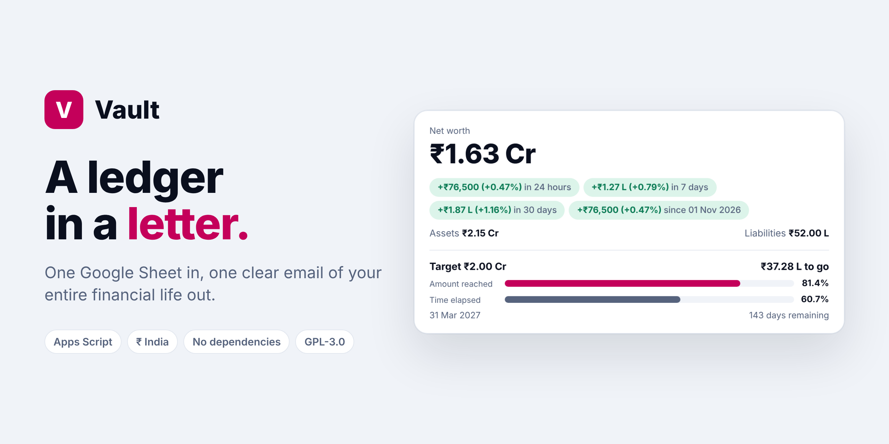

  <picture>
    <source media="(prefers-color-scheme: dark)" srcset="https://raw.githubusercontent.com/Floydimus02/Vault/main/banner-dark.png">
    <source media="(prefers-color-scheme: light)" srcset="https://raw.githubusercontent.com/Floydimus02/Vault/main/banner.png">
    
  </picture>

<h3 align="center"><i>A ledger in a letter.</i></h3>

Your finances from 10,000 feet down to 10 mm, built on one Google Sheet that only you can see.

  <a href="https://floydimus02.github.io/Vault/"><b>Try the demo</b></a> &nbsp;·&nbsp; <a href="#get-started"><b>Get started</b></a>

 

## Money lives everywhere

Where it comes from, how much is taxed, how much remains, where it is spent, where and when it is invested, how it performs, and how much is taxed again. Collating all of it, organising it and making sense of it, so every rupee works for you and every leak gets fixed, is tedious. And spreadsheet rows get boring very quickly.

The tenet is simple: don't sit on cash, make money work for you. Vault gives you the view from 10,000 feet down to 10 mm, so nothing escapes your radar and you can build the wealth you want.

It is for personal finance enthusiasts who love to capture every detail, for those who want discipline but don't know where to start, and for those with no visibility of their money. Vault brings method to the madness, structure to the data and clarity to the ambiguity.

## So I built Vault

I have tracked my finances for years, changing what I captured, how and when. As a visual thinker, I always wanted to *see* my money: where I stand, where I want to be, and the decisions that bridge the two.

**Version 1** was an automated email. **Version 2** is a web app on Google Apps Script. It works on any device, can sit behind your own domain, and carries Google's security: nobody but you can open the sheet or the app.

<picture>
  <source media="(prefers-color-scheme: dark)" srcset="https://raw.githubusercontent.com/Floydimus02/Vault/main/docs/img/app-dark.png">
  <source media="(prefers-color-scheme: light)" srcset="https://raw.githubusercontent.com/Floydimus02/Vault/main/docs/img/app-light.png">
  
</picture>

## What it does

Built function first.

<table>
  <tr>
    <td width="33%" valign="top"><b>Net worth, every day</b> A snapshot at midnight. A trend over 7 days, 30 days or 12 month ends, with changes since the last close.</td>
    <td width="33%" valign="top"><b>Every detail, one tap deep</b> Income, tax, spend, holdings, loan, rewards, insurance and locker, each with its own deep dive.</td>
    <td width="33%" valign="top"><b>Private in public</b> One toggle hides amounts above ₹25 L on Home and ₹1 Cr elsewhere, so you can open it anywhere.</td>
  </tr>
  <tr>
    <td valign="top"><b>Only you get in</b> The app runs as you and opens only for you. No server, database, tracker or outside service.</td>
    <td valign="top"><b>Live on refresh</b> Every open reads the sheet afresh. Prices follow <code>GOOGLEFINANCE</code>, which can lag, or any better source you plug in.</td>
    <td valign="top"><b>Simple to own</b> A sheet, a script and a page. Easy to build, change and deploy. Your data keeps whatever structure you like.</td>
  </tr>
  <tr>
    <td valign="top"><b>Your rules for net worth</b> Track anything without counting it, such as stock appreciation rights.</td>
    <td valign="top"><b>No empty boxes</b> A missing value is skipped, not shown as a blank.</td>
    <td valign="top"><b>Every holding, every lot</b> Gain, XIRR, long or short term, tax if sold today, and how it did against a fixed deposit after tax.</td>
  </tr>
  <tr>
    <td valign="top"><b>Tax, worked out</b> Both regimes, advance tax due and any interest, from your payslips and payouts. Past years kept.</td>
    <td valign="top"><b>Spend with pace</b> The month so far against your usual, a month-end estimate, and every category's trend.</td>
    <td valign="top"><b>Home loan, in full</b> Outstanding, rate history, EMIs and interest left, what a prepayment saves, and an alert if the EMI account runs low.</td>
  </tr>
  <tr>
    <td valign="top"><b>Rewards that don't lapse</b> Points in rupees, oldest redeemed first, with expiry dates.</td>
    <td valign="top"><b>Insurance with a memory</b> Cover per person, renewal alerts 30 days out, and premium growth over the years.</td>
    <td valign="top"><b>Ratios with bands</b> Savings, emergency cover, liquidity, debt and housing, each marked healthy or off target.</td>
  </tr>
</table>

## How it feels

Minimal and visual, with as much care for how it works as for how it looks. Tap search and the bottom bar turns into a search field, suggesting from your own holdings, payees, policies and locker items, and forgiving typos. Deep dives open as bottom sheets, so you never lose your place; going back returns you to where you were. Light and dark follow your device.

<picture>
  <source media="(prefers-color-scheme: dark)" srcset="https://raw.githubusercontent.com/Floydimus02/Vault/main/docs/img/app-dark-2.png">
  <source media="(prefers-color-scheme: light)" srcset="https://raw.githubusercontent.com/Floydimus02/Vault/main/docs/img/app-light-2.png">
  
</picture>

**[Try the demo](https://floydimus02.github.io/Vault/)**. It runs on made-up numbers; Vault makes the most sense with your own.

## Get started

You need a Google account and about 15 minutes.

**1. Copy the sheet**
1. Download [`Vault-template.xlsx`](Vault-template.xlsx).
2. In [Google Drive](https://drive.google.com): **New → File upload**, and choose it.
3. Open it and click **File → Save as Google Sheets**. Use this copy from now on.

**2. Add the script**
1. In the sheet: **Extensions → Apps Script**.
2. Delete everything in `Code.gs`, paste in [`Code.gs`](Code.gs) from this repository, and save.
3. Near the top, set `RECIPIENTS` to your email address, or leave it blank to send only to yourself.

**3. Approve it once**
1. In the bar above the code, choose `sendSnapshot` and click **Run**.
2. Allow the permissions: **Review permissions → your account → Advanced → Go to project → Allow**. The script reads your sheet, keeps one hidden history tab and emails you.
3. Check your inbox for the first snapshot.

**4. Schedule it**

Click the clock icon (**Triggers**) and add two triggers:

| Function | Event source | Type | Time |
|---|---|---|---|
| `recordDailyClose` | Time-driven | Day timer | Midnight to 1am |
| `sendSnapshot` | Time-driven | Any | Whenever you want the email. Skip it if you only want the app. |

**5. Turn on the web app**
1. In Apps Script, click **+** next to Files → **HTML**, and name it `Index`.
2. Delete what's in it, paste in [`Index.html`](Index.html), and save.
3. **Deploy → New deployment →** gear icon **→ Web app**. Set **Execute as: Me** and **Who has access: Only myself**. Click **Deploy**.
4. Open the **Web app URL** and bookmark it. To use your own domain, point it at this URL.
5. On your phone, open the same URL signed in to the same Google account, then add it to your home screen: Safari → Share → **Add to Home Screen**, or Chrome → ⋮ → **Add to home screen**.

**6. Put your money in**
1. Replace the example rows with yours, tab by tab. Keep the tab names, headings and row labels; the script finds everything by them. Delete any tab you don't need and its section disappears.
2. For live prices, use formulas such as `=GOOGLEFINANCE("INDEXNSE:NIFTY_50")` in the Markets block on **Portfolio**, and `=GOOGLEFINANCE("NSE:ITC")` in each holding's **Current Price**.

## Day to day

**Updates on its own**

| What | When |
|---|---|
| Net worth snapshot | Every night at midnight |
| Prices and NAVs | As `GOOGLEFINANCE` refreshes |
| Every figure, ratio and estimate | Each time you open the app or tap refresh |
| The email | On your schedule |

**You update**

| Cadence | What | Where |
|---|---|---|
| Monthly | Payslip | **CoI** tab, the month's column |
| Monthly | Spend | **Expenses** tab, the month's column |
| Monthly | Loan statement lines | **Loan schedule** |
| Monthly | EPF passbook | **EPF** |
| When it happens | A buy or sell | Its block on **XIRR**, and its units on **Portfolio** |
| When it happens | Dividend, SGB coupon or REIT payout | **Dividends & payouts** |
| When it happens | Reward points earned or redeemed | **Rewards ledger**, and the balance on **Net worth** |
| When it happens | Insurance renewal | **Insurance premiums** |
| When it happens | Locker visit or event | **Locker log**, **Events** |
| At each review | Values at review and the review date | **Net worth**: `Amount: T - X`, `Last updated` |
| Every April | New financial year | Copy the **Expenses** and **CoI** tabs, renamed for the new year |

## Make it yours

1. **Change a setting.** Open `Code.gs` and edit `CONFIG` at the top: email recipients, time zone, what's left out of net worth (`EXCLUDE`), rewards, the EMI alert, and how many days ahead events show.
2. **Change the look.** Edit the colour tokens under `:root` at the top of `Index.html`; `html.dark` holds the dark theme.
3. **Fit a different sheet.** Run `describeWorkbook` in Apps Script, then follow [`PROMPT.md`](PROMPT.md). An AI assistant rewrites only the parts that read your sheet.
4. **Publish it.** After any change: **Deploy → Manage deployments → ✏️ → Version: New version → Deploy**. The URL stays the same. To check first, open **Deploy → Test deployments**.

 

## Licence

Free software under the [GNU General Public License v3.0](LICENSE). Distributed without any warranty. Not financial or tax advice.
