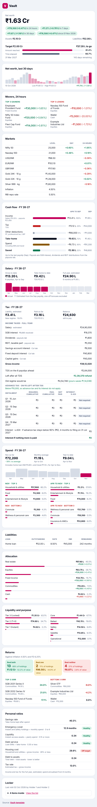

Vault Snapshot
================

A ledger in a letter. Inspired by the quiet discipline of a bank vault, Vault Snapshot turns one Google Sheet into a structured email of your entire financial life, designed for those who prioritise ownership of their data, clarity over noise, and the plain sincerity of the early internet, rejecting finance-app bloat: function over form.



Function
--------

*   **Sheet First:** Every figure is read or calculated from your own Google Sheet. Nothing is typed twice.
*   **Privacy Hardened:** Runs inside your Google account, with zero external services, libraries, servers or trackers.
*   **India Native:** ₹ in lakh and crore, April-to-March financial years, and both tax regimes under the Income-tax Act, 2025.
*   **Adaptable:** A ready-made AI prompt rewrites the script for your own sheet layout, leaving the calculations untouched.

Form
----

*   **Top-down Hierarchy:** What moves daily comes first, then money as it flows: in, taxed, spent, saved.
*   **Mature Visuals:** Paper-white cards, high-contrast type and a single accent colour, legible on any mail app and device.
*   **Silence over Blanks:** A section without data stays hidden instead of showing an empty figure.

## What's in this folder

| File | What it is |
|---|---|
| `Vault-template.xlsx` | The spreadsheet to start from, filled with made-up example data |
| `Code.gs` | The script that reads the sheet and sends the email |
| `PROMPT.md` | A ready-made prompt for an AI assistant, if you change the sheet's layout |
| `preview.png` | What the email looks like |
| `LICENSE` | GNU General Public License v3.0 |

You need only a Google account. No coding and no installation.

## Set up (about 10 minutes)

1. **Copy the template into Google Sheets.** Download `Vault-template.xlsx`. In [Google Drive](https://drive.google.com), click New → File upload and choose it. Open it, then click File → Save as Google Sheets.
2. **Add your numbers.** Replace the example rows with your own. Keep the tab names, column headings and row labels as they are, because the script finds everything by those words.
3. **Add the script.** In your Google Sheet, click Extensions → Apps Script. Delete everything in the editor, then paste the full contents of `Code.gs`. Click the save icon.
4. **Choose who gets the email.** Near the top of the script, find this line:
   ```js
   RECIPIENTS: '',
   ```
   Put your email address between the quotes, for example `RECIPIENTS: 'you@example.com',`. For more than one person, separate addresses with commas. Leave it empty to send it only to yourself.
5. **Send the first email.** In the bar above the code, pick `sendSnapshot` from the list and click Run. Google asks for permission the first time: click Review permissions, choose your account, then Advanced → Go to project → Allow. The script needs to read your sheet, add one hidden history tab and send email as you. Check your inbox.

## Send it automatically

1. In Apps Script, click the clock icon on the left (Triggers).
2. Click Add trigger.
3. Choose `sendSnapshot`, then "Time-driven", then how often and at what time.
4. Click Save. Add another trigger for each extra time you want the email.

## What the email shows

| # | Section | What you see |
|---|---|---|
| 1 | Net worth and target | Total, assets and liabilities, with changes over 24 hours, 7 days, 30 days and since your last review. Progress towards your target. |
| 2 | Last 30 days | Net worth for each day, with the low, the high and the change |
| 3 | Movers | Top 3 gainers and losers in the last 24 hours |
| 4 | Markets | Nifty 50, Nasdaq 100, USD, EUR, GBP, gold, silver, inflation, repo rate |
| 5 | Cash flow | Income, tax, take-home, spend and savings since 1 April |
| 6 | Salary | Gross and take-home so far, and a full-year estimate |
| 7 | Tax | Estimated tax, paid so far, balance, the other regime's figure, and advance tax due with any interest |
| 8 | Spend | This month, monthly average, year to date, and top and bottom 3 categories |
| 9 | Loans | Outstanding, rate, EMI and months remaining |
| 10 | Allocation | Where your money sits, by asset class |
| 11 | Liquidity and purpose | How quickly you can use each holding, and what it's for |
| 12 | Returns | Holdings that beat inflation and FDs, and the best and worst 3 returns |
| 13 | Personal ratios | Savings rate, emergency cover, debt and housing costs, tax rate |
| 14 | Locker | Last visit and what's inside |

A section without enough data is left out. The 24-hour, 7-day, 30-day and 30-day-trend figures appear once the script has run for that long.

## Changed the sheet's layout?

If you rename tabs or move things around, parts of the email may disappear. `PROMPT.md` walks you through fixing it with an AI assistant such as Claude, ChatGPT or Gemini, in three steps:

1. Run `describeWorkbook` in Apps Script. It prints your sheet's layout with numbers, dates and email addresses hidden.
2. Paste the prompt, the script and that layout into the assistant, with a note of what you changed.
3. Paste the updated script it returns back into Apps Script.

## Something not working?

| Problem | Fix |
|---|---|
| No email arrived | Check spam. Then in Apps Script, open Executions (the list icon on the left) to see the error. |
| A section is missing | Open Executions. The log names the tab or label it couldn't find. |
| "Authorisation required" | Run `sendSnapshot` once by hand and allow the permissions. |
| Market prices are blank | `GOOGLEFINANCE` can lag. Open the sheet, wait for prices to load, then run again. |
| The locker list won't open in Gmail | Gmail can't expand sections in an email. Tap "View the list" to open the sheet. Apple Mail opens it in place. |

## Your privacy

- The script runs inside your own Google account. It uses no outside service, library or server.
- Each run adds a row to a hidden tab, `_vault_snapshot_log`, in your sheet. It holds your figures, so share the sheet with care.
- The template and preview use only made-up data.

## Details

<details>
<summary>Sheet layout the script expects</summary>

The script finds tabs by name and finds columns and rows by their labels, so you can add your own tabs and columns around them. Upper and lower case don't matter.

| Tab name must contain | Needed? | Feeds |
|---|---|---|
| `net worth` | Yes | Net worth, target, movers, allocation, liquidity, returns, loans, ratios |
| `portfolio` | No | Markets |
| `expense` and the year, e.g. `Expenses FY 26-27` | No | Spend, cash flow, loan EMI |
| `coi` and the year, e.g. `CoI FY 26-27` | No | Salary, tax, cash flow |
| `dividend` or `payout` | No | Other income |
| `locker` | No | Locker |

**Net worth tab.** Column headings: `L1` (Asset or Liability), `L2` (asset class), `L3` (category), `Custodian`, `L4` (vehicle), `L5` (name), `Amount: T` (value now), `Amount: T - X` (value at your last review), `XIRR` (return, or a loan's interest rate), `> FD?`, `Liquidity` (Tier 1 counts as instant access) and `Function` (Safety counts towards emergency cover). Below the holdings: `Last updated` and `Target net worth by 31st Mar 2027`, with values in column C.

**Expenses tab.** Month headings from April to March, an `Average` column, and a `Total` row. Name loan rows with `loan` or `EMI`, and travel rows with `travel`.

**CoI tab.** A `SELECT TAX REGIME` cell, with `New Regime` or `Old Regime` to its right. Tax inputs labelled in column B. A payslip register below, with months from April to March, an `INCOME` block and a `DEDUCTIONS` block. Leave future months empty.

The template follows this layout exactly.
</details>

<details>
<summary>Settings at the top of Code.gs</summary>

| Setting | Default | What it does |
|---|---|---|
| `RECIPIENTS` | empty (you) | Who gets the email |
| `TIMEZONE` | `Asia/Kolkata` | Time zone for dates and the financial year |
| `SPREADSHEET_ID` | empty (this sheet) | Set this only if the script lives outside the sheet |
| `LOG_TAB` | `_vault_snapshot_log` | Name of the hidden history tab |
| `LOG_KEEP_ROWS` | `800` | Rows of history to keep |
| `TREND_DAYS` | `30` | Days in the trend chart |
| `TOP_MOVERS` | `3` | Gainers and losers listed |
| `TOP_XIRR` | `3` | Best and worst returns listed |
| `ITR_FILING_DATE` | empty (31 July after the year) | Filing date used for interest under section 424 |
</details>

<details>
<summary>How the numbers are worked out</summary>

**Salary.** Payslips entered so far are actual. The rest of the year uses the latest payslip's regular pay, leaving out one-off items such as bonuses, arrears and encashment.

**Other income.** SGB interest, dividends and REIT payouts come from the payouts tab. An SGB that has paid one coupon this year is counted for a second, since coupons are half-yearly. REIT interest and other income are taxable. A REIT dividend is taxable when TDS was deducted on it. SPV debt repayment is a return of capital.

**Tax.** The full year is estimated under both regimes, using the rules from FY 2025-26:

| | New regime | Old regime |
|---|---|---|
| Slabs | Nil to ₹4 L; 5% to ₹8 L; 10% to ₹12 L; 15% to ₹16 L; 20% to ₹20 L; 25% to ₹24 L; 30% above | Nil to ₹2.5 L; 5% to ₹5 L; 20% to ₹10 L; 30% above |
| Standard deduction | ₹75,000 | ₹50,000 |
| Rebate | Up to ₹60,000 if income is ₹12 L or less | Up to ₹12,500 if income is ₹5 L or less |
| Deductions | Employer NPS, leave encashment | Also HRA, home loan interest (up to ₹2 L), 80C (up to ₹1.5 L, EPF included), 80D (₹25,000 self, ₹50,000 parents), 80TTA (₹10,000), 80CCD(1B) (₹50,000) |

Short-term gains are taxed at 20%; long-term gains at 12.5% above ₹1.25 L. Surcharge is 10% above ₹50 L, 15% above ₹1 Cr and 25% above ₹2 Cr (37% above ₹5 Cr in the old regime), capped at 15% on capital gains. Cess is 4%.

**Advance tax** (Income-tax Act, 2025):

- Due when tax left after TDS is ₹10,000 or more (section 404).
- Instalments: 15% by 15 June, 45% by 15 September, 75% by 15 December, 100% by 15 March.
- Section 425 (formerly 234C): 1% a month on each shortfall.
- Section 424 (formerly 234B): if under 90% is paid, 1% a month on the shortfall until filing.

**Loans.** The EMI is the smallest monthly amount in the loan's expense row, since bigger months usually include a prepayment. Months remaining = −ln(1 − r × P ÷ EMI) ÷ ln(1 + r), where P is the outstanding amount and r the monthly rate.

**Spend.** Monthly totals come from the `Total` row; the monthly average from the `Average` column.

**Ratios.**

| Ratio | How | Guide |
|---|---|---|
| Savings rate | (take-home − spend) ÷ take-home | Higher is better |
| Emergency cover | (instant-access + safety holdings) ÷ monthly spend | 3 to 6 months |
| Liquidity | instant-access holdings ÷ yearly spend | 0.15 or more |
| Debt service | loan EMIs ÷ take-home | 0.30 or less |
| Housing cost | household costs ÷ gross income | 28% or less |
| Debt to assets | total debt ÷ total assets | Lower is better |
| Tax rate | estimated tax ÷ gross income | |
</details>

## Limits

- Tax rules are simplified. Marginal relief, HRA calculation and some income heads aren't modelled. Treat the figures as estimates, not tax advice.
- `GOOGLEFINANCE` prices refresh on Google's schedule.

Licence
-------
[](https://www.gnu.org/licenses/gpl-3.0.html)

Copyright (C) 2026 Floydimus.

Vault Snapshot is free software: you may redistribute and/or modify it under the terms of the [GNU General Public License v3.0](https://www.gnu.org/licenses/gpl-3.0.html) as published by the Free Software Foundation. Any distributed version, modified or not, must remain open under the same licence; it can never be made closed-source or proprietary. It is distributed WITHOUT ANY WARRANTY, and it is not financial or tax advice. See the [LICENSE](LICENSE) file for the full text.
