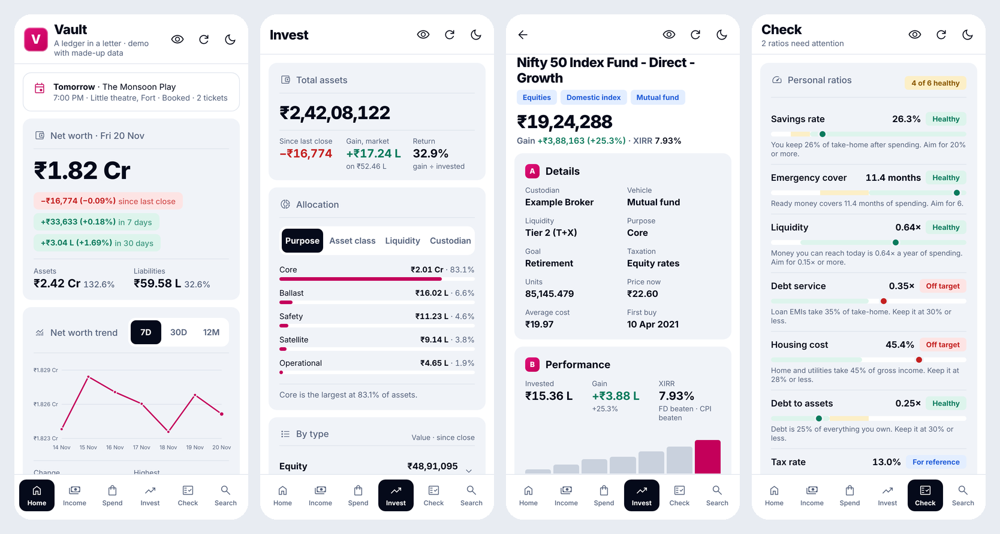
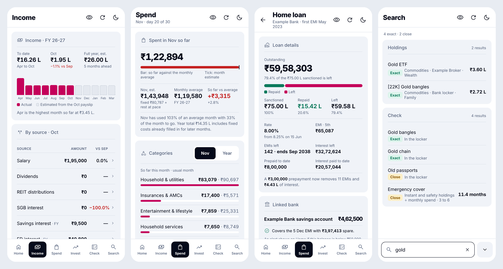
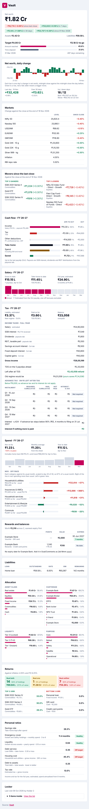

Vault
=====

<picture>
  <source media="(prefers-color-scheme: dark)" srcset="https://raw.githubusercontent.com/Floydimus02/Vault/main/banner-dark.png">
  <source media="(prefers-color-scheme: light)" srcset="https://raw.githubusercontent.com/Floydimus02/Vault/main/banner.png">
  
</picture>

**A ledger in a letter.** Vault turns one Google Sheet into two views of your entire financial life: a structured **email** that arrives when you choose, and a private **web app** you can open on any phone or computer. Both run inside your own Google account. Nothing leaves it.

**[Open the live demo →](https://floydimus02.github.io/Vault/)** (made-up data, works on any device)

[Why Vault](#why-vault) · [What you get](#what-you-get) · [Set up](#set-up-about-15-minutes) · [Use](#how-to-use-it) · [Modify](#how-to-modify-it) · [Sheet layout](#sheet-layout) · [Help](#something-not-working)

---

Why Vault
---------

### Function

| | What it means for you |
|---|---|
| **Extremely structured** | Every figure sits in a fixed place: net worth, then income, tax, spend, investments and checks. Each deep dive follows the same order: details, performance, comparison, ledger. |
| **Little technical knowledge needed** | Copy a spreadsheet, paste two files, click Deploy. No installs, no servers, no coding. |
| **Privacy first** | The script runs in your Google account, as you, and only you can open the app. No outside service, library, tracker or database. |
| **Your data, your structure** | The script finds tabs and columns by their names, so you can add rows, columns and tabs freely. A ready-made AI prompt adapts it to a different layout. |
| **Build once, use anywhere** | One web app link works on a desktop browser, mobile web, Android and iPhone (add it to your home screen). The email reads well in any mail app. |
| **Real time, mostly** | The app reads the sheet every time you open it or tap refresh. Market prices follow `GOOGLEFINANCE`, which can lag up to 20 minutes; fund NAVs update once a day. |
| **A deep dive into everything** | Every holding down to each purchase lot, gain, XIRR and tax if sold today. Salary, tax, spend, loan, rewards, insurance and locker, each with its own page. |

### Form

- **Top-down hierarchy.** What moves daily comes first, then money as it flows: in, taxed, spent, saved.
- **Calm and legible.** Light grey cards on white, one accent colour, a single typeface. Light and dark themes follow your device.
- **Plain language.** Every note gives the definition or the logic in one line, not a reference to a cell.
- **Silence over blanks.** A section without data stays hidden instead of showing an empty figure.
- **Privacy at a glance.** One tap hides large amounts: above ₹25 L on Home, and ₹1 Cr or more everywhere else.

---

What you get
------------

<picture>
  <source media="(prefers-color-scheme: dark)" srcset="https://raw.githubusercontent.com/Floydimus02/Vault/main/docs/img/app-dark.png">
  <source media="(prefers-color-scheme: light)" srcset="https://raw.githubusercontent.com/Floydimus02/Vault/main/docs/img/app-light.png">
  
</picture>

<picture>
  <source media="(prefers-color-scheme: dark)" srcset="https://raw.githubusercontent.com/Floydimus02/Vault/main/docs/img/app-dark-2.png">
  <source media="(prefers-color-scheme: light)" srcset="https://raw.githubusercontent.com/Floydimus02/Vault/main/docs/img/app-light-2.png">
  
</picture>

### Two ways to see it

| | Email | Web app |
|---|---|---|
| What | One long, ordered letter | Six tabs with deep-dive pages and bottom sheets |
| When | On the schedule you set, e.g. every morning | Whenever you open it |
| Where | Any mail app | Any browser; add to home screen on Android or iPhone |
| Needs | `Code.gs` | `Code.gs` and `Index.html` |

You can use either one, or both. They read the same sheet and share the same calculations.

### The web app

| Tab | What you see |
|---|---|
| **Home** | Net worth with changes since the last close, over 7 and 30 days; assets and liabilities; the last 7 days of daily change, with where net worth is headed over the next 7 and a likely range; markets with symbols and dates; top movers; a line for any event in the next 2 days; an alert if the EMI account runs low. |
| **Income** | The year's income by month, actual and estimated; each source opens its own page. **Salary** opens payslips: any month or year, gross → tax → net, and the annual view against the same months last year. **SGB interest** groups coupons by bond; **REIT** and **dividends** list every payout with TDS. **Tax**: liability under both regimes, advance tax due and any interest, the full computation for this and past years. |
| **Spend** | Spend this month so far, the month's estimate, and the monthly average. Categories sorted by size, for the month or the year, each with its items and 6-month trend. Home loan EMI with the account's balance. Rewards and vouchers in rupees, with expiries. |
| **Invest** | Total assets and returns. Allocation by purpose, asset class, liquidity and custodian. Holdings by type, with EPF split into employee, employer and pension. |
| **Holding page** | Details; gain and XIRR; performance against a fixed deposit with tax on exit; the ledger of every lot with units, entry price, value, gain and a long or short term tag. EPF shows its passbook by year; PPF its deposits and interest. |
| **Home loan page** | Outstanding against sanctioned, rate history, EMIs left, interest left, the linked bank account, and every EMI and prepayment, sortable. |
| **Check** | Personal ratios with a healthy band; insurance cover per person, with premiums paid and the next due date; the locker page with what's inside, the last visit and the full log. |
| **Search** | Tap it and the bar turns into a search field with suggestions from your own data. Finds holdings, spends, payouts, policies and locker items, even with typos. |

### The email

<details>
<summary>See the full email</summary>

<picture>
  <source media="(prefers-color-scheme: dark)" srcset="https://raw.githubusercontent.com/Floydimus02/Vault/main/preview-dark.png">
  <source media="(prefers-color-scheme: light)" srcset="https://raw.githubusercontent.com/Floydimus02/Vault/main/preview.png">
  
</picture>
</details>

| # | Section | What you see |
|---|---|---|
| 1 | Net worth and target | Total, assets and liabilities; changes since the last close, over 7 and 30 days and since your last review; progress towards your target |
| 2 | Daily change | 30 days of daily moves, with the best and worst day |
| 3 | Markets and movers | Indices, currencies, gold, silver, inflation, repo rate; top gainers and losers |
| 4 | Cash flow, salary, tax | Income, tax, take-home, spend and savings since 1 April; advance tax due |
| 5 | Spend | This month, average, year to date, top and bottom categories |
| 6 | Loans, allocation, liquidity, returns | Outstanding and EMIs left; where your money sits; best and worst XIRR |
| 7 | Rewards, ratios, locker | Points and vouchers with expiry; personal ratios; last locker visit |

---

What's in this repository
-------------------------

| File | What it is |
|---|---|
| `Vault-template.xlsx` | The spreadsheet to start from, filled with made-up example data on every tab |
| `Code.gs` | The script: reads the sheet, sends the email and serves the web app |
| `Index.html` | The web app's page |
| `PROMPT.md` | A ready-made prompt for an AI assistant, if your sheet's layout differs |
| `docs/` | The live demo (GitHub Pages): the same page reading `docs/data.json`, made from the template |
| `banner*.png`, `preview*.png`, `docs/img/` | The pictures on this page |
| `LICENSE` | GNU General Public License v3.0 |

You need only a Google account.

---

Set up (about 15 minutes)
-------------------------

### 1. Copy the sheet

1. Download `Vault-template.xlsx`.
2. In [Google Drive](https://drive.google.com), click **New → File upload** and choose it.
3. Open it, then click **File → Save as Google Sheets**. Work in this Google Sheets copy from now on.

You can keep the example data for a first look, then replace it with yours (step 6).

### 2. Add the script

1. In your Google Sheet, click **Extensions → Apps Script**.
2. Delete everything in `Code.gs`, paste the full contents of `Code.gs` from this repository, and click the save icon.
3. Near the top, find `RECIPIENTS: '',`. Put your email address between the quotes, or leave it empty to send only to yourself.

### 3. Approve it once

1. In the bar above the code, pick **`sendSnapshot`** and click **Run**.
2. Google asks for permission: **Review permissions → your account → Advanced → Go to project → Allow**. The script needs to read your sheet, add one hidden history tab and send email as you.
3. Check your inbox. That's the email working.

### 4. Schedule it

Click the clock icon on the left (**Triggers**) → **Add trigger**, twice:

| Function | Event source | Type | Time | Why |
|---|---|---|---|---|
| `recordDailyClose` | Time-driven | Day timer | 11pm to midnight | Records net worth once a day. Every "since last close", trend and mover uses it. Sends nothing. |
| `sendSnapshot` | Time-driven | Any | Any, e.g. 8am to 9am | Sends the email. Add one per time you want it. Skip if you only want the app. |

### 5. Turn on the web app

1. In Apps Script, click **+** next to Files → **HTML**. Name it `Index` (capital I; the editor adds `.html`).
2. Delete what's in it, paste the full contents of `Index.html`, and save.
3. Click **Deploy → New deployment**. Click the gear → **Web app**. Set **Execute as: Me** and **Who has access: Only myself**. Click **Deploy**.
4. Open the **Web app URL** it shows. Bookmark it.
5. On your phone, open the same URL and sign in with the same Google account:
   - **iPhone**: Safari → Share → **Add to Home Screen**.
   - **Android**: Chrome → ⋮ → **Add to home screen**.

### 6. Make it yours

Replace the example rows with your own, tab by tab. Keep the tab names, column headings and row labels, because the script finds everything by those words ([Sheet layout](#sheet-layout)). Delete any tab you don't need; its section simply disappears.

To make market prices live, replace the numbers in the Markets block on the **Portfolio** tab with formulas such as:

```
=GOOGLEFINANCE("INDEXNSE:NIFTY_50")          Nifty 50
=GOOGLEFINANCE("CURRENCY:USDINR")            USD/INR
```

And for each mutual fund or stock, put its price in the **Current Price** column the same way, e.g. `=GOOGLEFINANCE("NSE:ITC")`.

---

How to use it
-------------

| You want to | Do this |
|---|---|
| See today's position | Open the app, or read the morning email |
| Get the newest numbers while the app is open | Tap refresh ↻ in the top bar |
| Hide large amounts before showing your screen | Tap the eye in the top bar |
| Switch light and dark | Tap the moon or sun in the top bar |
| Look into anything | Tap a row with › to open its page or sheet; tap ⓘ for the working |
| Find something | Tap Search; type a holding, payee, insurer or locker item |
| Record a new purchase | Add a row to the holding's block on the **XIRR** tab and update its units on **Portfolio** |
| Log a month's spend | Fill the month's column on **Expenses** |
| Add a payslip | Fill the month's column in the payslip register on **CoI** |
| Record a locker visit | Add a row on **Locker log** with what was inside before and after |
| Track something without counting it in net worth | Keep it on the **Net worth** tab and add its name to `EXCLUDE` in `Code.gs` |

Things update by themselves: the daily close at 11 PM, prices through `GOOGLEFINANCE`, and every calculation each time you open the app or the email goes out.

---

How to modify it
----------------

After any change to `Code.gs` or `Index.html`, save, then publish it: **Deploy → Manage deployments → ✏️ → Version: New version → Deploy**. Your app's URL stays the same. To check a change before publishing, open **Deploy → Test deployments**; that URL always runs the latest saved code.

| You want to change | Where | What to edit |
|---|---|---|
| Who gets the email | `Code.gs`, top | `RECIPIENTS` |
| When the email arrives | Apps Script → Triggers | Edit or add a `sendSnapshot` trigger |
| A tab's name | `Code.gs`, `CONFIG.TABS` | The pattern that matches it, e.g. `loan: /loan schedule/i` |
| What counts in net worth | `Code.gs`, `EXCLUDE` | Holdings matching it are tracked on Invest only |
| Which rows count as rewards | `Code.gs`, `REWARDS` | Words in the vehicle or instrument name |
| The EMI low-balance alert | `Code.gs`, `EMI_GUARD` | Account, minimum balance, EMI day, days before |
| Events on Home | `Code.gs`, `APP.EVENT_DAYS_AHEAD` | How many days ahead an event shows |
| Trend and projection | `Code.gs`, `APP.TREND_DAYS`, `APP.PROJECT_DAYS` | Days shown and days projected |
| How many movers | `Code.gs`, `APP.MOVERS` | Count by size of the day's move |
| Healthy bands for ratios | `Code.gs`, `RATIO_BANDS_` and the ratio list in `appCheck_` | Thresholds per ratio |
| Tax rules | `Code.gs`, `readIncomeTax_` (slabs, rebate, surcharge, cess) and `appTaxRule_` (holding periods) | Rates and limits |
| Colours, fonts, spacing | `Index.html`, `:root` at the top of the `<style>` block | The colour tokens; `html.dark` for dark mode |
| Your sheet's layout is different | `PROMPT.md` | Run `describeWorkbook`, give the output to an AI assistant, paste back the code it returns |

<details>
<summary>All settings at the top of Code.gs</summary>

| Setting | Default | What it does |
|---|---|---|
| `RECIPIENTS` | empty (you) | Who gets the email |
| `TIMEZONE` | `Asia/Kolkata` | Time zone for dates and the financial year |
| `SPREADSHEET_ID` | empty (this sheet) | Set only if the script lives outside the sheet |
| `LOG_TAB` | `_vault_snapshot_log` | The hidden history tab |
| `LOG_KEEP_ROWS` | `800` | Rows of history to keep |
| `TREND_DAYS` | `30` | Days in the email's trend chart |
| `TOP_MOVERS`, `TOP_XIRR` | `3` | Gainers, losers and best and worst returns in the email |
| `ITR_FILING_DATE` | empty (31 July) | Filing date for interest under section 424 |
| `EXCLUDE` | stock appreciation rights | Holdings tracked but left out of net worth |
| `CLOSE_LABEL` | `11 PM` | Shown in the email; match it to the daily close trigger |
| `REWARDS`, `REWARD_EXPIRY_YEARS` | see file | Reward rows and how long points last |
| `EMI_GUARD` | see file | The EMI account alert |
| `APP` | see file | Web app: event days, movers, trend days, projection days |
</details>

---

Sheet layout
------------

The script finds tabs by name and columns and rows by their labels. Upper and lower case don't matter, and you can add your own columns and tabs around them. The template follows this layout exactly.

| Tab name contains | Needed? | Feeds |
|---|---|---|
| `net worth` | Yes | Everything: holdings, net worth, allocation, movers, target |
| `portfolio` | No | Units and prices, markets, EPF split, totals |
| `xirr` (exact) | No | Purchase lots, XIRR and exit tax on each holding page |
| `expense` + year, e.g. `Expenses FY 26 - 27` | No | Spend, EMI, premiums paid |
| `coi` + year, e.g. `CoI FY 26 - 27` | No | Salary, payslips, tax; earlier years for history |
| `dividend` or `payout` | No | SGB, REIT and dividend income |
| `epf` (exact) | No | EPF passbook |
| `loan schedule` | No | Home loan page |
| `rewards ledger` | No | Reward points and expiries |
| `income & estimations` | No | Insurance cover (the `Person`, `Category`, `Type`, `Cover`, `Insurer` block) |
| `events` (exact) | No | The event line on Home |
| `locker` | No | Locker page |

<details>
<summary>Key columns and labels</summary>

**Net worth.** Headings `L1: Group` (Asset or Liability), `L2: Class`, `L3: Category`, `Custodian`, `L4: Vehicle`, `L5: Instrument`, `Amount: T` (value now), `Amount: T - X` (value at your last review), `XIRR`, `> FD?` (its formula holds your FD rate, e.g. `6.25%`), `> CPI?`, `Taxation` (a rate such as `0.125` for equity rules, `Slab rate` or `Tax free`), `Liquidity` (Tier 1 = instant), `Function` (Safety counts towards emergency cover), `Goal / Comments` (put an expiry in square brackets, e.g. `[30 Jun 2027]`). Below the holdings: `Last updated` and `Target net worth by 31st Mar 2028`, values in column C.

**Linking a holding to its lots.** Point `Amount: T` at its Portfolio row (e.g. `=Portfolio!H2`) and `XIRR` at its XIRR block's Today row (e.g. `=XIRR!H73`). That's how the holding page finds units, cost and every purchase.

**XIRR.** One block per holding: rows of `Date`, `Side` (Buy, Sell, Deposit, Interest), `Quantity`, `Price`, `Amount` (negative for money in), then a `Today` row whose `Quantity` is `=SUM(...)` of the block.

**Expenses.** Month headings April to March, a `Total` column, a `Monthly Avg` column and a `Total` row. Rows filled in ahead for later months count as fixed costs.

**CoI.** A `SELECT TAX REGIME` cell with `New Regime` or `Old Regime`, tax inputs, and a payslip register with an `INCOME` block and a `DEDUCTIONS` block. Earlier years can use the simpler layout of `CoI FY 25 - 26` in the template.

**Loan schedule.** Loan details at the top (`Provisioning bank`, `Sanctioned amount`, `Current RoI`, `EMI amount`, `NACH debit from`), then the bank statement from `Post Date`. EMIs, prepayments and rate changes are read from the statement's descriptions.
</details>

---

Demo and GitHub Pages
---------------------

The [live demo](https://floydimus02.github.io/Vault/) is the real web app page, reading a snapshot of the template's made-up data (`docs/data.json`) instead of a Google Sheet. It is hosted free on GitHub Pages from the `docs/` folder.

To host it from your own copy of this repository: **Settings → Pages → Build and deployment → Deploy from a branch → `main` / `/docs` → Save**.

**Your own Vault doesn't go on GitHub Pages.** Pages serves public files only, so it cannot read your Google Sheet, and anything placed there can be read by anyone. Your personal app stays on its Apps Script URL, where Google checks it is you before it opens.

---

Something not working?
----------------------

| Problem | Fix |
|---|---|
| No email arrived | Check spam. Then in Apps Script open **Executions** (the list icon) to see the error. |
| A section is missing | Its tab or label wasn't found. **Executions** names it; see [Sheet layout](#sheet-layout). |
| "Authorisation required" | Run `sendSnapshot` once by hand and allow the permissions. |
| "No HTML file named Index was found" | The HTML file must be named exactly `Index`. |
| The app still shows the old version | Deploy → Manage deployments → ✏️ → Version: **New version**. Check with the /dev URL under Test deployments. |
| "Since last close" or the trend is empty | Add the `recordDailyClose` trigger. They fill in from the second night. |
| Market prices are blank | `GOOGLEFINANCE` can lag. Open the sheet, wait for prices, then refresh. |

---

Your privacy
------------

- The script runs in your own Google account, as you. It uses no outside service, library or server.
- The web app is deployed as **Only myself**: Google asks you to sign in, so nobody else can open it and search engines can't index it.
- The daily close adds a row to a hidden tab, `_vault_snapshot_log`, in your sheet. It holds your figures, so share the sheet with care.
- The template, the demo and every picture here use only made-up data.

Limits
------

- Tax rules are simplified (Income-tax Act, 2025, as applied from FY 2026-27). Marginal relief and some income heads aren't modelled. Treat figures as estimates, not tax advice.
- Projections are a straight line through the last 7 days, not a forecast.
- `GOOGLEFINANCE` prices refresh on Google's schedule.

Licence
-------
[](https://www.gnu.org/licenses/gpl-3.0.html)

Free software under the GNU General Public License v3.0. See `LICENSE`. Distributed without any warranty. Not financial or tax advice.
